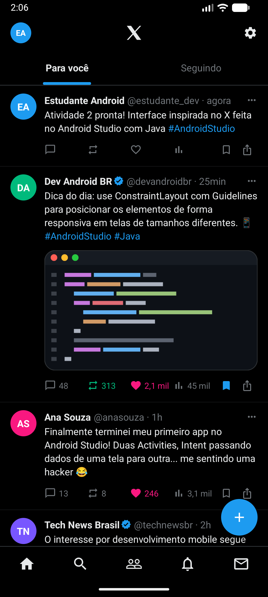
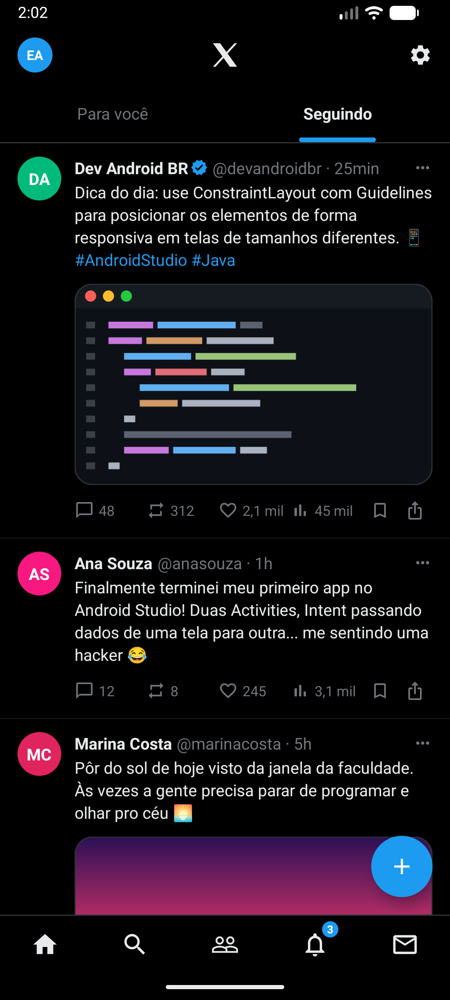
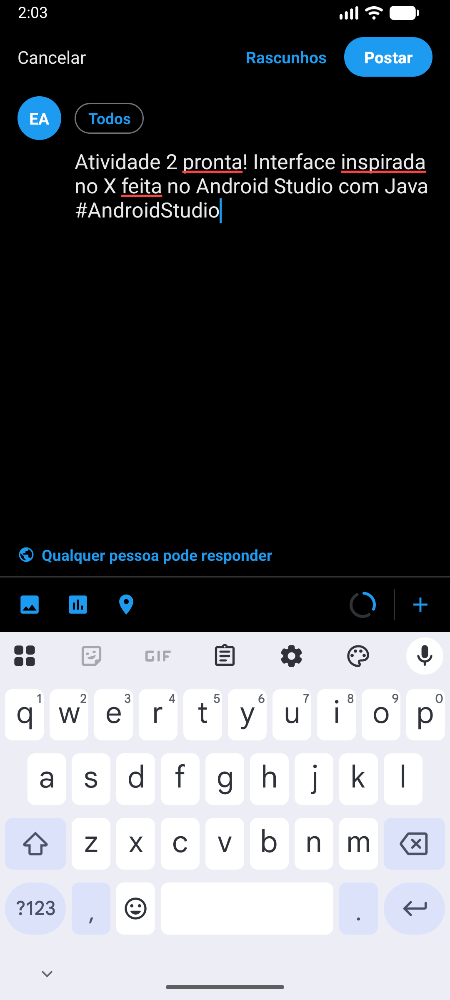
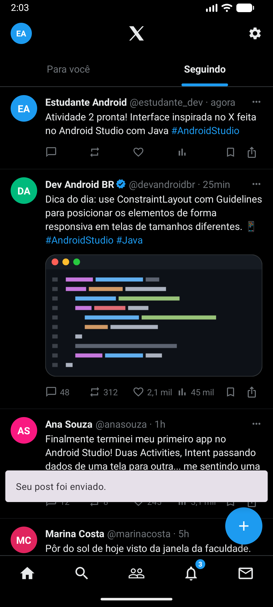

# AppX — interface inspirada no X (Twitter)

Atividade 2 da disciplina **Programação para Dispositivos Móveis**: implementação da interface gráfica semelhante à de um aplicativo real — neste caso, o **X (antigo Twitter)**, no modo escuro.

Projeto Android nativo em **Java**, com layouts em **XML** (Views), desenvolvido no **Android Studio**.

> Projeto acadêmico, sem vínculo com o X Corp. Todos os perfis, posts e assuntos exibidos são fictícios.

## 🎬 Vídeo do app rodando

[▶️ Assistir à demonstração (docs/demo.mp4)](docs/demo.mp4)

## 📱 Telas

| Início ("Para você") | Aba "Seguindo" | Detalhe do post |
|:---:|:---:|:---:|
|  |  |  |

| Novo post | Post enviado | Explorar |
|:---:|:---:|:---:|
|  |  |  |

## ✨ Funcionalidades

- **Linha do tempo** com abas *Para você* e *Seguindo* (indicador azul na aba ativa).
- **Posts** com foto de perfil, selo de verificado, @usuário, tempo relativo, texto com `#hashtags`/`@menções` destacadas e imagem opcional.
- **Ações** de curtir (coração rosa com animação), repostar (verde), salvar (azul), visualizações e compartilhar (abre o compartilhamento do Android).
- **Detalhe do post** com data completa, estatísticas, lista de respostas e campo para responder.
- **Novo post** pelo botão flutuante, com contador circular de caracteres (limite de 280) — o texto volta para a linha do tempo e aparece no topo.
- **Explorar** com busca, abas de categorias e lista de assuntos do momento filtrável.
- **Barra de navegação inferior** com Início, Buscar, Comunidades, Notificações (com badge) e Mensagens.

## 🧩 Conceitos da disciplina aplicados

| Conceito | Onde |
|---|---|
| `ConstraintLayout` + `Guideline` | `activity_main.xml` (divisão das abas em 50%), layouts dos itens |
| `MaterialToolbar` | Barra superior das telas Início e Detalhe |
| `TextView`, `ImageView`, `EditText`, `Button` | Todas as telas |
| `ListView` + `ArrayAdapter` personalizado | `PostAdapter` (posts) e `AssuntoAdapter` (assuntos) |
| Várias `Activity` | `MainActivity`, `NovoPostActivity`, `DetalhePostActivity`, `ExplorarActivity` |
| `Intent` explícita com extras | Abrir o detalhe enviando o `id_post`; devolver o texto do novo post (`texto_post`) |
| `Intent` implícita | Compartilhar post (`ACTION_SEND`) |
| Recursos `drawable` vetoriais | Ícones, logo e imagens dos posts em `res/drawable` |
| `<include>` de layout | `barra_navegacao.xml` reutilizada em duas telas |

## 🗂️ Estrutura

```
app/src/main/
├── AndroidManifest.xml
├── java/com/example/appx/
│   ├── MainActivity.java          # Linha do tempo (abas, lista, botão flutuante)
│   ├── NovoPostActivity.java      # Escrever novo post
│   ├── DetalhePostActivity.java   # Detalhe + respostas
│   ├── ExplorarActivity.java      # Busca e assuntos do momento
│   ├── PostAdapter.java           # Adapter da ListView de posts
│   ├── AssuntoAdapter.java        # Adapter da ListView de assuntos
│   ├── BarraNavegacao.java        # Lógica da barra inferior
│   ├── DadosApp.java              # Dados fictícios em memória
│   ├── Formatador.java            # Números (2,1 mil), datas, avatar, destaques
│   ├── Post.java                  # Modelo de post
│   └── Assunto.java               # Modelo de assunto
└── res/
    ├── layout/                    # activity_*.xml, item_*.xml, barra_navegacao.xml
    ├── drawable/                  # ícones vetoriais e ilustrações
    └── values/                    # cores, textos e tema escuro
```

## ▶️ Como executar

1. Abra a pasta do projeto no **Android Studio** (*File → Open*).
2. Aguarde a sincronização do Gradle.
3. Selecione um emulador (ou um celular com depuração USB / espelhamento com scrcpy).
4. Clique em **Run ▶**.

Ou pelo terminal: `gradlew assembleDebug` — o APK é gerado em `app/build/outputs/apk/debug/`.

**Requisitos:** Android Studio recente (AGP 9.5), `compileSdk`/`targetSdk` 37, `minSdk` 26.
